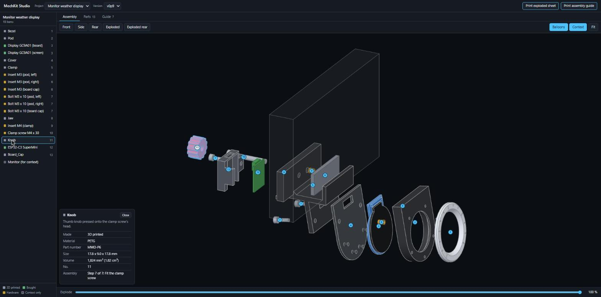
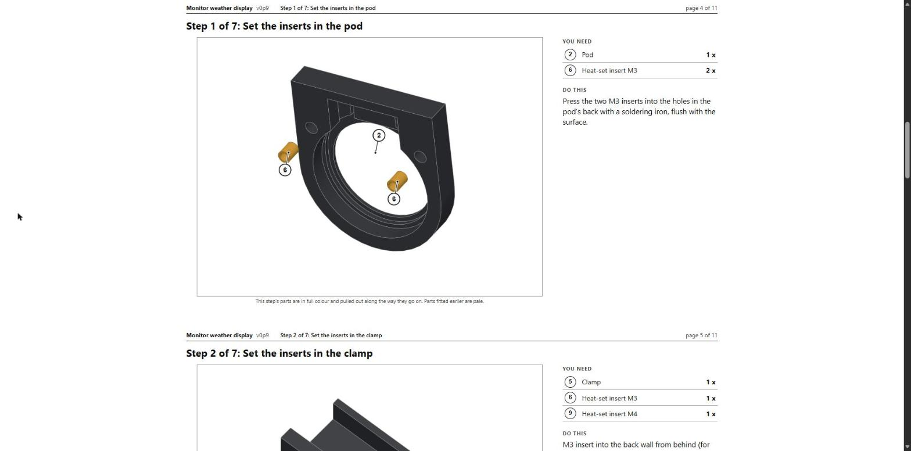
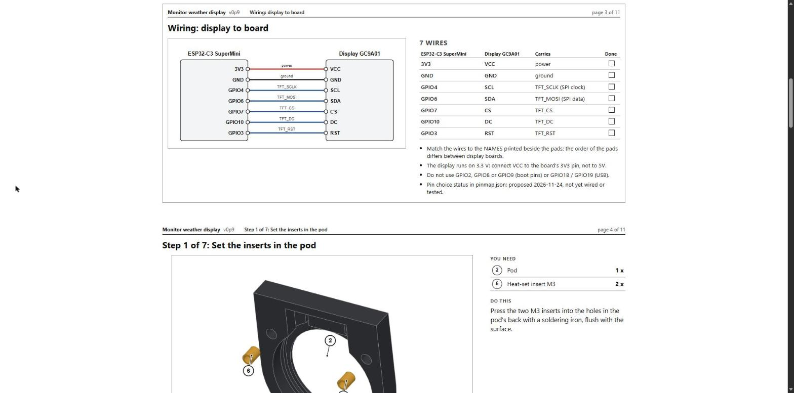
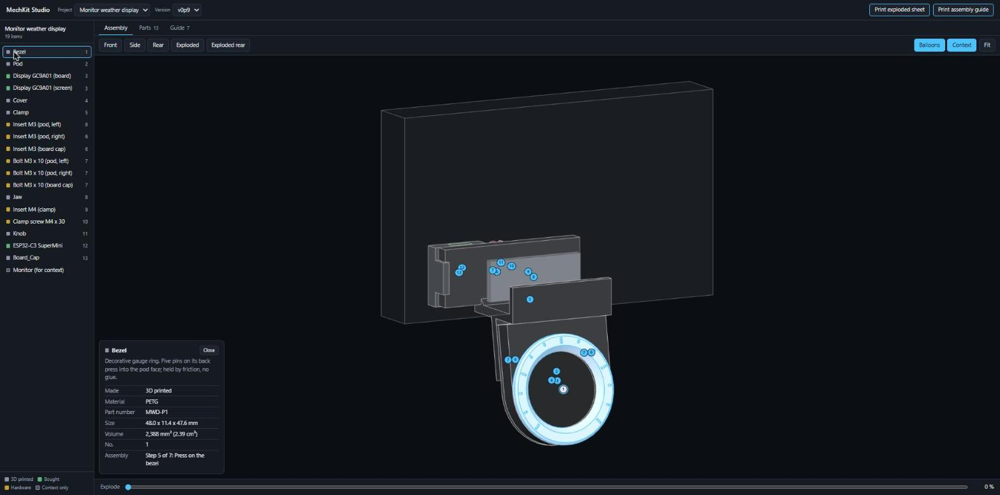
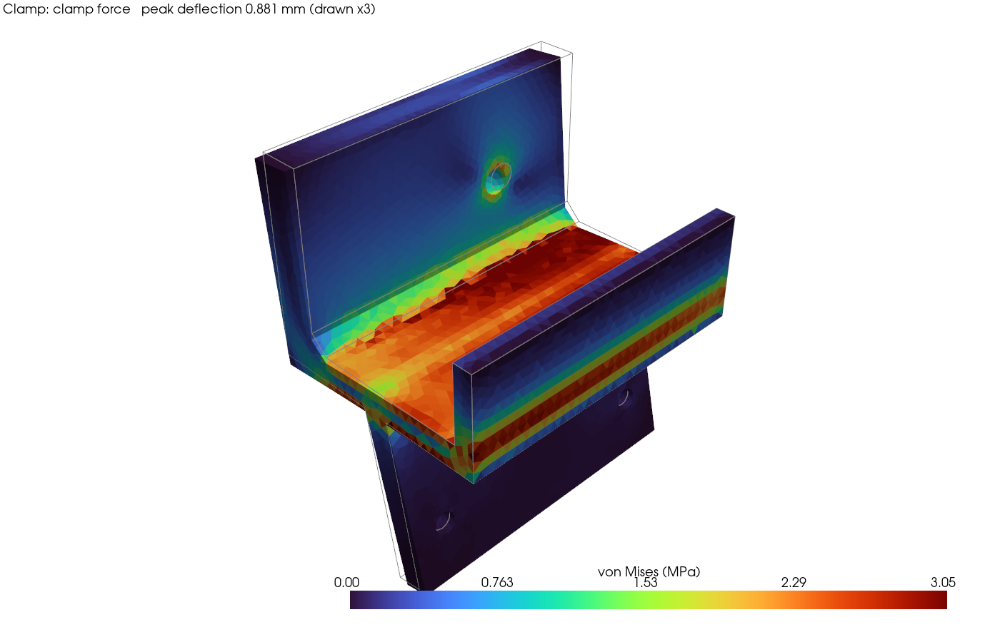

# MechKit

Agentic tooling for mechanical design. An AI coding agent takes your intent and constraints, writes the parts as
parametric CAD code, checks them against the bought parts they must fit and against mechanical simulation, produces
the files to make them, and a web front end shows you the build and prints its assembly instructions. You decide at
gates; the agent does the work between them.



## What it is, exactly

MechKit is **not** a one-click generator and contains no model of its own. It is the kit an AI coding agent (it was
built with and for [Claude Code](https://claude.com/claude-code)) works with, plus the rules that keep the agent
honest:

- **Intent and constraints in writing.** A brief and a `requirements.json` per project. Every dimension is tagged
  *stated*, *measured*, *scaled* or *assumed*, so a guess can never pass as a fact.
- **Bought parts as data.** Each purchased part has an `interface.json` (dimensions with tags, how it mounts) and a
  stand-in solid, so the design is checked against what it has to fit.
- **Geometry as code.** Parts are plain Python functions on [build123d](https://github.com/gumyr/build123d)
  (OpenCascade). No CAD window is needed; a build runs in seconds and can be repeated exactly.
- **Checks that return data.** Overlaps and clearances between parts, requirement results, print sizes.
- **Mechanical simulation.** STEP -> gmsh -> [CalculiX](https://www.calculix.de) static analysis with load cases
  placed by geometric selectors, two-mesh convergence, and a pass / fail judgement. Results carry a tag too:
  *calibrated* or *assumed*. An assumed result may rank options; it never approves a design, and neither does one
  with solver warnings, disagreeing meshes, or geometry changed since it was run.
- **Gates.** The agent stops for a person at: the brief and where the work lives, the concept, anything bought,
  the pre-print review, and anything that touches real hardware.
- **A front end for the person.** MechKit Studio: 3D view, exploded view, parts table, and two printable outputs,
  an exploded sheet and a step-by-step assembly guide with wiring, tools and commissioning pages.
- **Firmware alongside.** One `pinmap.json` per project feeds both the firmware header and the guide's wiring page.

## The worked example

[`examples/monitor-weather-display`](examples/monitor-weather-display) is a complete project: a round display that
clamps under a monitor (ESP32-C3 + GC9A01, seven printed parts). It went from a few sentences of intent to parts
that were printed, assembled and mounted, over nine revisions driven by one-line fit reports.

| The assembly guide it prints | Wiring page, generated from the pin map |
|---|---|
|  |  |

| Selecting a part in Studio | Clamp under load (assumed material) |
|---|---|
|  |  |

## Status

| Works today | Partly | Planned, not built |
|---|---|---|
| Project spin-up with the folder gate | Material data: the printed-PETG card is **assumed**; the calibration tooling exists but no measured prints back it yet | Tolerance stack-ups from measured printer behaviour |
| Requirement checks | Printed pages were checked on screen, not yet on paper | Motion simulation (tipping, mechanisms) |
| Headless CAD helpers (build123d) | Autodesk Fusion bridge: experimental, needs a separate add-in that is not part of this repository | Parameter optimisation |
| Structural simulation with a known-answer benchmark | Developed and tested on Windows 11 only | Laser-cut / sheet parts, and with them builds in more than one material and process |
| Presentation manifest, labelled picture sheets | | A process-neutral part description |
| MechKit Studio: viewer, exploded sheet, assembly guide | | |

Today the only fabrication process is filament 3D printing. Multi-material, multi-process builds are the direction,
not a shipped feature.

## Quick start

Requirements: [uv](https://docs.astral.sh/uv/) (it installs Python 3.12 for you) and Node.js 20 or newer.

```
git clone https://github.com/nick0451/mechkit.git
cd mechkit
uv sync                                   # Python environment
cd studio/web && npm install && npm run build && cd ../..
uv run python -m mechkit studio           # opens http://127.0.0.1:8765 with the example loaded
```

Studio listens on 127.0.0.1 only and loads nothing from the internet. It lists projects found beside the kit's
folder and in `examples/`; point it elsewhere with `--projects DIR` or the `MECHKIT_PROJECTS` variable.

Rebuild the example from its script (parts, checks, renders, manifest):

```
uv run python examples/monitor-weather-display/parts/custom/build.py
```

### Simulation (optional)

The solver is not included. Get a CalculiX `ccx` executable (for Windows, the official builds linked from
<https://www.calculix.de>), then either put it under `tools/ccx/` or set `MECHKIT_CCX` to its full path. Check the
whole chain against a hand calculation before trusting it:

```
uv run python -m mechkit.sim.benchmark                                   # clamped beam, known answer
uv run python -m mechkit sim examples/monitor-weather-display
```

### Tests

Plain scripts; each ends with a line like `54 checks, 0 failed`.

```
uv run python tests/test_phase0.py        # spin-up, gate, requirements
uv run python tests/test_phase1.py        # simulation chain (skipped without the solver)
uv run python tests/test_present.py       # manifest, layout, sheets
uv run python tests/test_studio.py        # Studio backend
cd studio/web && npm test                 # web app logic
```

## Working with an agent

Open the folder in Claude Code (or another coding agent that reads a project instruction file). [`CLAUDE.md`](CLAUDE.md)
tells it how the kit is used: the gates, the rules about dimensions and simulation results, the commands, and the
mistakes already paid for. A typical session is a few sentences from you ("a display that clips under my monitor,
tilted slightly up; the monitor is 21.5 mm thick"), questions back at the gates, print files, and then your
one-line fit reports turning into the next revision.

Start a new build with:

```
uv run python -m mechkit propose --name "Desk fan mount" --purchased 2 --custom 3
uv run python -m mechkit new --name "Desk fan mount" --where own --confirmed "<who decided, when>"
```

`new` refuses to create anything without `--confirmed`: where a build lives is a person's decision.

## Layout

```
mechkit/            the Python package: spin-up, requirements, CAD helpers, simulation, presentation, Studio backend
studio/             the web app (React, TypeScript, three.js) and its contract
examples/           the worked example
tests/              test scripts
calibration/        test-bar definitions for measuring a printed material
```

## Built on

build123d and OpenCascade (geometry), gmsh (meshing), CalculiX (solver, GPL, not distributed here), PyVista
(pictures), FastAPI and uvicorn (Studio backend), React and three.js (Studio front end). Each keeps its own licence.

The name: an unrelated continuum-mechanics package is published on PyPI as `mechkit`. This project is not on PyPI.

Developed with Claude Code.

## Licence

MIT. See [LICENSE](LICENSE).
