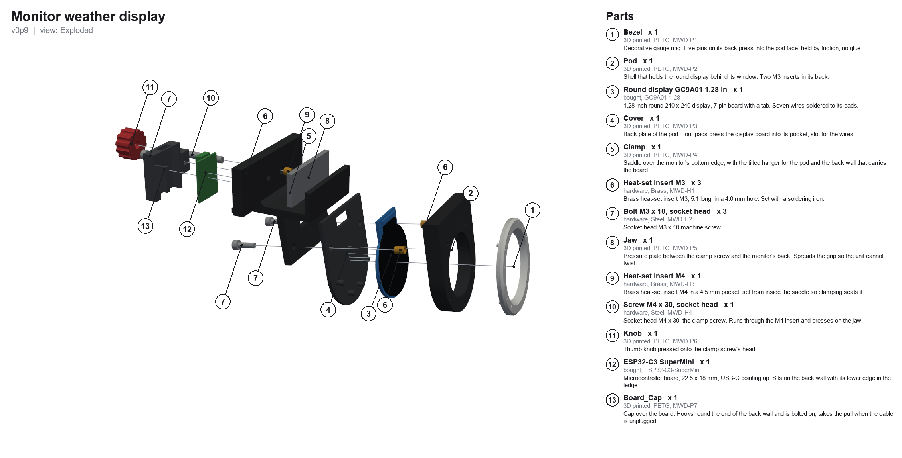

# Example: monitor weather display

A small round display that clamps under the bottom edge of a monitor and shows day, time and weather over a sky that
follows the sun, the weather and the season. ESP32-C3 SuperMini + a 1.28 inch GC9A01 round display, seven printed
parts in PETG, heat-set inserts and a screw clamp.

It was designed with MechKit from a few sentences of intent and a handful of measurements, through nine printed
revisions (v0.1 to v0.9). This folder is a snapshot of v0.9, the version that was printed, assembled and mounted.



## What is in here

| Path | What it is |
|---|---|
| `brief.md`, `requirements.json` | the intent, with every dimension tagged stated / measured / scaled / assumed, and what "done" means |
| `parts/purchased/*/interface.json` | the bought parts: dimensions with their tags, and how they mount |
| `parts/custom/build.py` | the whole design as one Python script: parameters, one function per part, stand-ins for the bought parts, overlap checks, print orientation, renders, and the presentation data (items, assembly steps, guide) |
| `pinmap.json` | the only place pins are written; the firmware header and the guide's wiring page come from it |
| `firmware/` | PlatformIO project (Wi-Fi setup portal, network time, Open-Meteo weather, sky drawing) |
| `sim/` | load cases generated from the design parameters, the simulation report and stress pictures |
| `exports/v0p9/` | print files (STL, already oriented for the bed), STEP files, and the presentation manifest |
| `exports/v0p9/dfm_report.json`, `drawings.pdf` | manufacturability and geometry checks of each part as printed, and a drawing per part |
| `renders/` | pictures of v0.9 and the labelled sheets |
| `tests/check_sky_maths.py` | known-answer checks of the sun-position and season maths |

## Run it

From the kit's folder:

```
uv run python examples/monitor-weather-display/parts/custom/build.py      # rebuild parts, checks, renders, manifest
uv run python -m mechkit studio                                           # look at it, print the guide
uv run python examples/monitor-weather-display/sim/make_loadcases.py      # needs the CalculiX solver, see the main README
uv run python -m mechkit sim examples/monitor-weather-display
```

## Honest status

- The printed parts fit and the unit is mounted. The bezel holds by friction on its five pins; no glue was needed.
- The firmware compiles. When this snapshot was taken it had not yet been run on the finished unit: treat the
  commissioning page of the assembly guide as the first real test.
- The strength results use an ASSUMED material card for printed PETG (no calibration prints were measured), so they
  rank options but do not prove the clamp.
- The pin choice in `pinmap.json` carries its own status line, which is printed on the wiring page.
- Layer height and infill used for the prints were not recorded.
- The printing check (general FDM rules) first failed the Pod on three slivers 0.01 to 0.05 mm thick, left where two
  cuts nearly met. Far below one extrusion line, so the printed Pod was fine; the cuts were cleaned up after printing
  (geometry moved by 0.04 mm at most) and all seven parts now pass.
